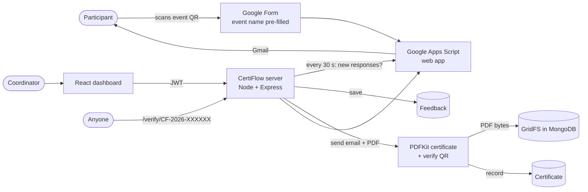
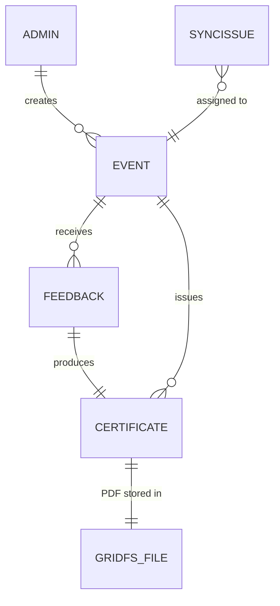

# CertiFlow — Architecture & Design

**Problem.** After a college event, collecting feedback and sending certificates is manual: coordinators export a
sheet, edit certificates one by one, email them individually and lose track of who received what. Fake
certificates are hard to detect.

**Solution.** Participants scan a QR code → fill a Google Form (details + review) → CertiFlow automatically generates
a personalised PDF certificate, emails it, and stores every certificate and its data in MongoDB. Anyone can verify a
certificate by its ID or QR code.

## 1. System flow

Public verification: CertiFlow copies each certificate (masked register number) to a **Certificate Register** Google
Sheet through the same script. The QR code on the certificate opens the script's public page
(`…/exec?verify=CF-2026-XXXXXX`), which looks the ID up in that sheet, so it works from any phone while the
CertiFlow server stays on the coordinator's laptop.

Certificate designs: an event uses either CertiFlow's standard layout or an image design (a ready-made preset such as
RMKCET Query Quest, or an uploaded PNG/JPG). The image is stored in GridFS; the name, date and verify QR are placed
using positions saved as fractions of the image size, edited by dragging in the dashboard.

Email retries: failed emails are retried automatically after 2, 4, 8 and 16 minutes; when Gmail's daily limit is
reached they wait 3 hours without counting as a failure.

Design choice: **the server always calls Google, never the reverse.** That means the system works on a laptop
without a public URL, and emails go out from the coordinator's own Gmail through `MailApp`, with no SMTP passwords.

Steps:
1. Coordinator creates an event; CertiFlow builds a QR code of the Google Form link with the event name pre-filled.
2. Participant scans and submits Name, Register No, College, Event Name, Email, Rating (1–5), Review option, Comments.
3. The sync service fetches new responses from the Apps Script (`doGet?action=responses&since=…`).
4. Each response is validated and matched to an event by name (case-insensitive). Problems become **SyncIssues**:
   unknown event, duplicate register number, feedback closed, or invalid data.
5. A PDF certificate with a unique ID and a verification QR is generated and saved in **GridFS**, plus a
   `Certificate` record with a snapshot of the participant and event details and a SHA-256 hash of the PDF.
6. The certificate is emailed (`doPost` → `MailApp.sendEmail` with attachment). Delivery status is tracked; failed
   emails are retried automatically up to 3 times and can be re-sent from the dashboard.
7. Public `/verify` page shows whether an ID is genuine, revoked, or unknown.

## 2. Tech stack

| Layer | Choice |
|---|---|
| Data entry | Google Form, created automatically by Google Apps Script |
| Backend | Node.js, Express 5 |
| Database | MongoDB with Mongoose. Built-in local MongoDB (mongodb-memory-server, persistent) or MongoDB Atlas |
| File storage | GridFS (PDFs stored inside MongoDB) |
| Certificates | PDFKit + qrcode |
| Email | Gmail via Apps Script `MailApp` (default) or Nodemailer SMTP |
| Frontend | React 19, Vite, Tailwind CSS 4, React Router, Axios, lucide icons |
| Auth | JWT + bcrypt, roles: admin / coordinator |

## 3. Database design

### events
| Field | Type | Notes |
|---|---|---|
| name | String | required |
| nameKey | String | unique, lower-cased name used to match form answers |
| slug | String | unique, URL-safe |
| organizer, venue, description | String | organizer required |
| date | Date | required |
| formUrl | String | optional custom form link |
| feedbackOpen | Boolean | closed → new responses become issues |
| certificate.title, certificate.signatories[≤3] | | printed on the certificate |
| stats.feedbackCount, stats.certificatesIssued | Number | dashboard counters |
| createdBy | → Admin | |

### feedbacks
| Field | Type | Notes |
|---|---|---|
| event | → Event | |
| participant.name / regNo / college / email | String | regNo upper-cased; email validated |
| rating | 1–5 | |
| review | Excellent / Very Good / Good / Average / Poor | |
| comments | String | optional |
| formResponseId | String | unique — each Google response processed once |
| certificate | → Certificate | |

Unique index **(event, participant.regNo)**: one feedback and one certificate per student per event.

### certificates
| Field | Notes |
|---|---|
| certificateId | unique public ID, e.g. `CF-2026-7K3QXM` (no 0/O/1/I) |
| event, feedback | feedback is unique (1 certificate per feedback) |
| participant {name, regNo, college, email} | snapshot |
| eventSnapshot {name, date, organizer} | snapshot |
| file {gridFsId, filename, size, sha256} | the PDF in GridFS |
| delivery {status, attempts, lastError, sentAt} | pending / sent / failed |
| status | active / revoked |
| issuedAt | |

### admins
name, email (unique), password (bcrypt, never returned), role (admin / coordinator).

### settings
key/value: Google script URL and secret, form URL, pre-fill entry ID, last sync time and errors, JWT secret.

### syncissues
formResponseId (unique), code, reason, answers, status (open / resolved / dismissed).

### GridFS bucket `certificates.files` / `certificates.chunks`
The PDF bytes.

## 4. API

| Method | Endpoint | Access |
|---|---|---|
| GET | `/api/health` | public |
| GET | `/api/public/verify/:certificateId` | public |
| GET | `/api/auth/bootstrap` | public (first-login hint) |
| POST | `/api/auth/login` | public |
| GET | `/api/auth/me` | login |
| POST | `/api/auth/change-password` | login |
| GET/POST/DELETE | `/api/auth/users` | admin |
| GET/POST | `/api/events` | login |
| GET/PATCH/DELETE | `/api/events/:id` | login |
| GET | `/api/events/:id/qr` (coloured SVG QR, college logo in the centre) | login |
| GET/PATCH | `/api/events/:id/access` (attendance check: registered only, event code) | login |
| GET | `/api/events/:id/code` (current rotating code for the projector) | login |
| GET/POST/DELETE | `/api/events/:id/registrations` (registered list, upload .xlsx/.csv) | login |
| GET/POST | `/api/events/:id/awards`, `/api/events/:id/awards/preview.pdf`, `/api/events/meta/award-types` | login |
| POST/GET | `/api/events/:id/bulk/preview`, `/api/events/:id/bulk`, `/api/events/:id/bulk/:jobId` (issue from Excel) | login |
| GET | `/api/events/:id/report.pdf` (event report) | login |
| POST | `/api/public/my-certificates` (register no + email, rate limited) | public |
| GET | `/api/public/certificates/:id/pdf?t=…` (download link valid 1 hour) | public |
| GET/PUT | `/api/settings/org` (college name and department) | login / admin |
| PUT/POST | `/api/settings/org/logo` (upload PNG/JPG, or `{use:'crest'|'none'}`) | admin |
| GET | `/api/public/org`, `/api/public/org/logo` | public |
| GET | `/api/events/:id/feedback` (with analytics) | login |
| GET | `/api/events/:id/export.csv` | login |
| GET | `/api/certificates?search=&event=&delivery=&status=&page=` | login |
| GET | `/api/certificates/export.csv` | login |
| GET | `/api/certificates/:id/download` | login |
| POST | `/api/certificates/:id/resend` | login |
| PATCH | `/api/certificates/:id/status` | login |
| GET | `/api/dashboard` | login |
| POST | `/api/dashboard/issues/:id/assign`, `/dismiss` | login |
| GET | `/api/settings`, `/api/settings/google/script` | login |
| PUT/DELETE | `/api/settings/google` | admin |
| POST | `/api/settings/google/test`, `/api/settings/sync` | login |

## 5. Security

- Apps Script answers only requests carrying a 48-character secret generated per installation.
- Passwords hashed with bcrypt (cost 12); JWT sessions; role checks for admin actions.
- Public verify page hides all but the last 4 digits of the register number.
- Helmet security headers; CSV exports guard against spreadsheet formula injection.
- Duplicate protection at the database level (unique indexes), not just in code.

## 6. Testing done

End-to-end test with a simulated Google script (same request/redirect behaviour as Apps Script):
5 form responses → 2 certificates issued and emailed. The 3 problem responses were each flagged with the right
reason: duplicate register number, unknown event, and invalid email. Also tested:
- creating the missing event auto-issued the waiting certificate;
- a late response was picked up by the automatic 30-second sync;
- resend to a corrected email works, revoke and restore are reflected on the verify page;
- events with certificates cannot be deleted;
- data persists across restarts.

## 7. Future scope

Certificate templates with background images, bulk certificate download as ZIP, WhatsApp delivery, attendance
check-in to restrict certificates to attendees, and online deployment with a custom domain.

## Version 8 additions

**Attendance check.** Each event has `access.registeredOnly` and `access.codeRequired`. Before a form response
becomes a certificate, `syncService.processResponse` checks the register number against the `registrations`
collection and the typed code against `eventCode.codeMatches`. The code is `HMAC-SHA256(secret, time window)`
reduced to 4 digits; a response is accepted for the window it was submitted in and the two before, so people
have up to 15 minutes to fill the form. Failed checks become `SyncIssue`s with the codes `not_registered` /
`wrong_code`; approving one from the dashboard re-runs it with the checks skipped. Uploading the list or switching a
check off re-checks the held responses automatically.

**Awards.** Award certificates are `Certificate` documents with `kind: 'award'` and `award: {type, title, line}`,
not linked to a feedback (the unique feedback index is partial, so many awards can exist). On the RMKCET design
they use `rmkcet-query-quest-award.jpg`, a copy with the "Certificate of Participation" heading removed, and
CertiFlow draws "CERTIFICATE OF MERIT" and a navy ribbon with the award title. Other designs use the built-in
layout with the college logo.

**Issue from Excel.** `utils/sheet.js` reads .xlsx (ExcelJS) or CSV, finds the columns by their headings, and
`services/bulkIssue.js` issues the certificates in a background job that the page polls; when Gmail's daily
limit is hit, the rest wait and the sync loop sends them later.

**Event report.** `services/reportPdf.js` draws a multi-page A4 PDF with PDFKit: header with logo, key numbers,
feedback bar charts, colleges, awards, comments and the participant table, with page numbers.
